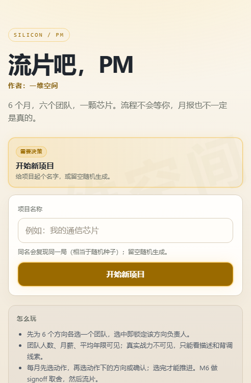
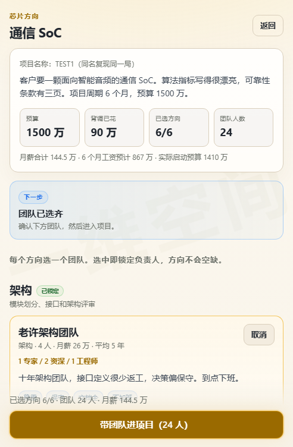
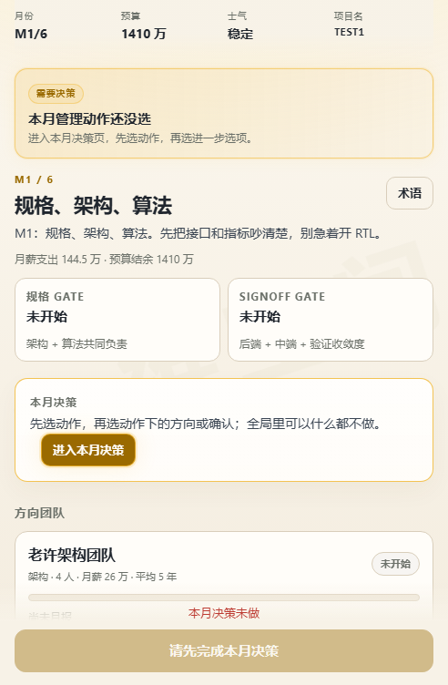
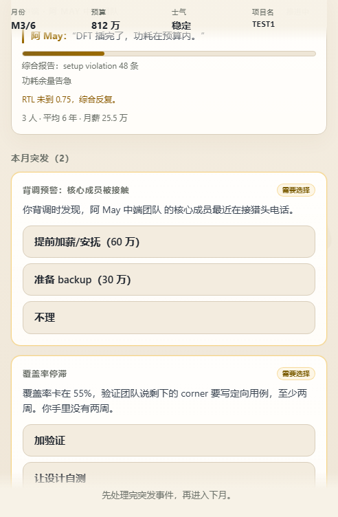
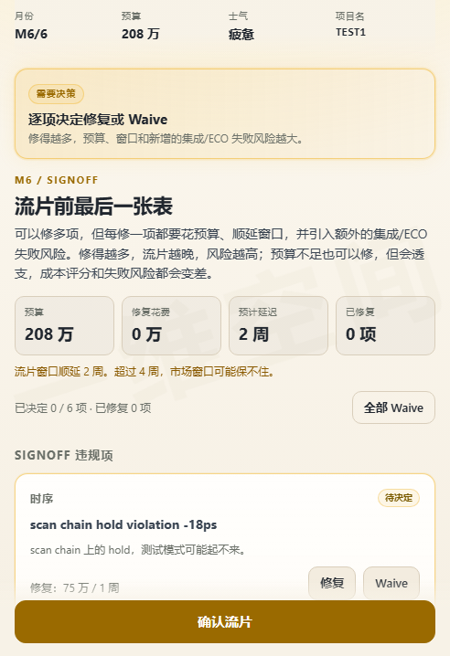
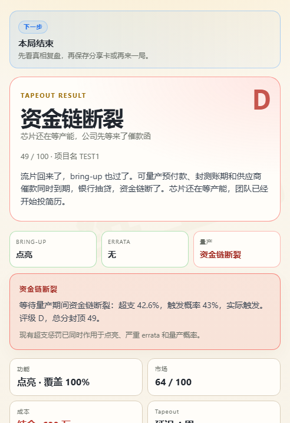
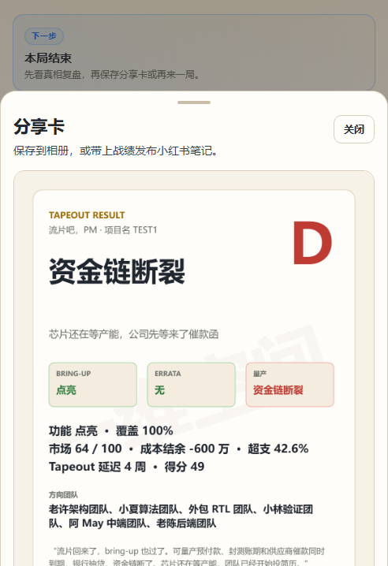

# 流片吧，PM

作者：一维空间

一个纯离线的芯片项目管理文字游戏。你是项目经理，为 6 个方向各选一个负责团队，用 6 个月把一颗通信 SoC 送到流片。

流程不会等你，月报也不一定是真的。

## 截图

| | |
|---|---|
|  |  |
|  |  |
|  |  |
|  |  |
|  |  |

## 直接玩

网页版：打开 `dist/index.html`，或把整个目录放到任意静态托管上。不需要服务器，也不需要联网。

小红书小工具：上传 `release/liupian-pm-minitool.zip`，在创服平台模拟器、Android 真机和 iOS 真机完成验证。

## 怎么玩

1. 给项目起名，然后为 6 个方向各选一个团队。同名会复现同一局。
2. 每月进入决策页，选择一个管理动作，再选择方向或确认。
3. 推进到月报，查看进度、覆盖率、预算和团队发言。
4. 处理突发事件，然后在 M6 做 Signoff 修复或 Waive 取舍。
5. 流片后查看 Bring-up、Errata、量产结果和最终结局。

## 游戏特色

- 30 个候选团队，每个方向 5 个，按项目名称展示 3 个
- 6 个月并发推进，团队月报可能吹牛，也可能隐瞒风险
- 加班、画饼、加薪、团建、审计、买 IP/外包等多种决策
- 背调线索、团队隐藏特质、人员流动和资金链风险
- 6 个 Signoff 违规项，可以修，也可以带着风险 Waive
- 8 个结局，包含资金链断裂
- 结局可生成 3:4 分享卡，并保存到相册或发布到小红书

## 版本

- 当前版本：`0.2.0`
- 版本记录：[`versions/`](versions/)
- 小工具包：[`release/liupian-pm-minitool.zip`](release/liupian-pm-minitool.zip)

## 说明

- 纯离线 H5，无网络请求、无外部资源依赖
- 项目名称同时作为随机种子
- 人物、团队和项目均为虚构
- 当前为单项目版本

## License

MIT
